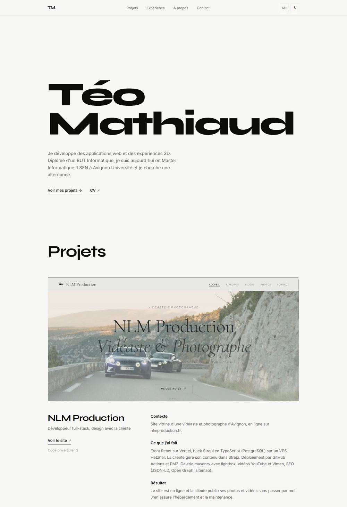

# Portfolio de Téo Mathiaud

Mon portfolio : mes projets, mes stages et ma formation. Je suis en Master Informatique ILSEN à Avignon Université et je cherche une alternance.

**En ligne : [teomthd.github.io/portfolio](https://teomthd.github.io/portfolio/)**



## Stack

- React 19 et Vite
- CSS par composant, sans framework
- Textes en français et en anglais
- Tests avec Vitest et React Testing Library
- Déployé sur GitHub Pages par GitHub Actions à chaque push sur `main`

## Lancer en local

```bash
npm install
npm run dev        # http://localhost:5173/portfolio/
npm run test:run   # tests
npm run build      # build de production dans dist/
```
